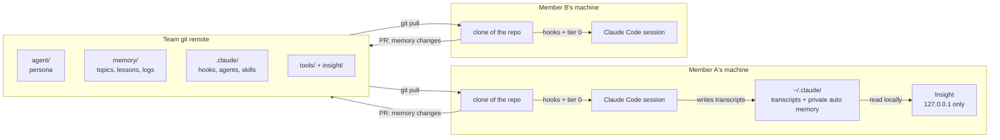
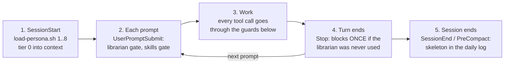
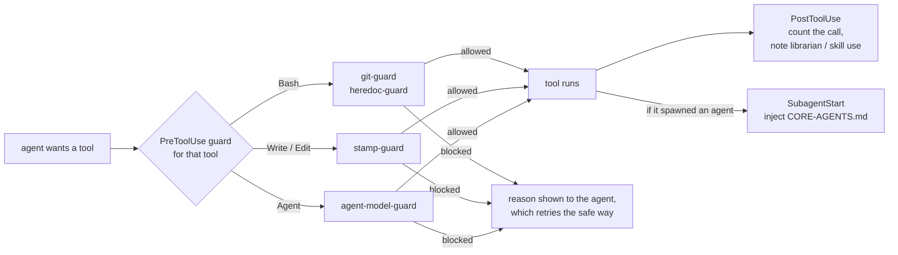
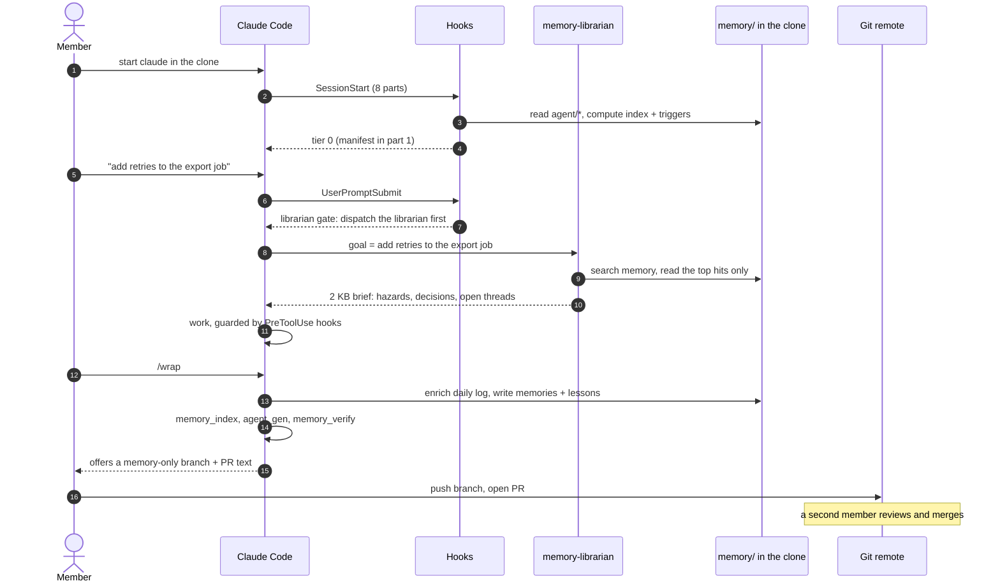
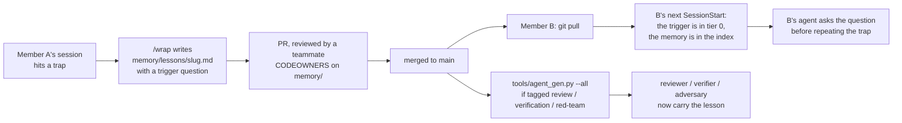
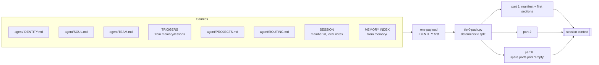
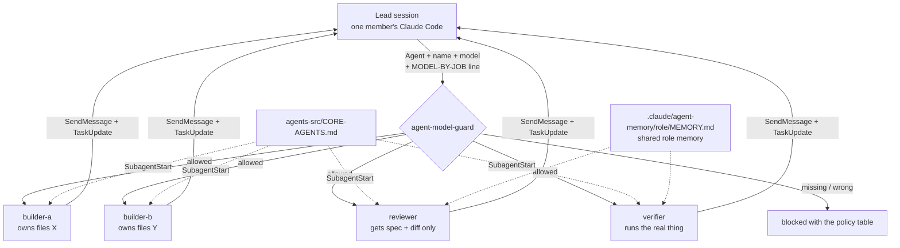
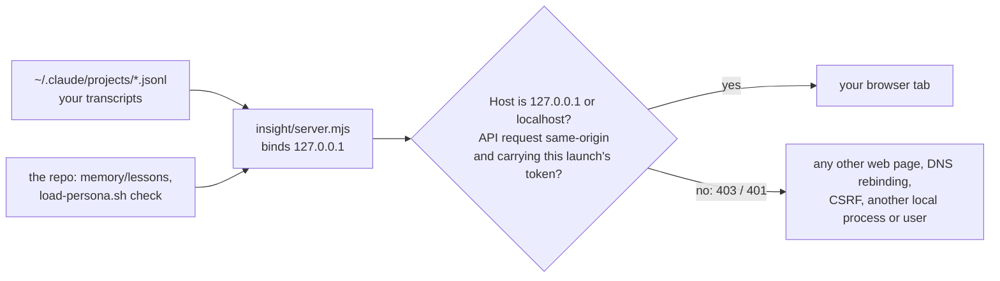
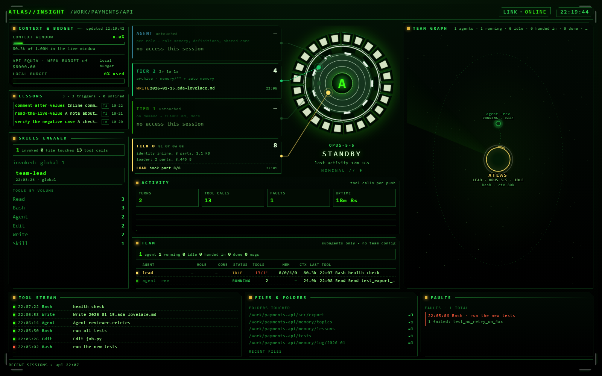
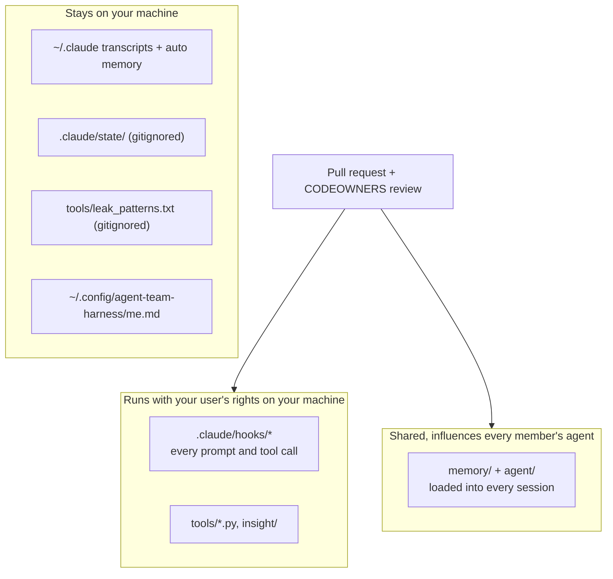

# agent-team-harness

A shared Claude Code agent for a whole team: **one persona, one memory, one set of lessons**, used by every member in
their own clone. What one member's session learns reaches every other member's session once it is merged.

> Diagrams are [Mermaid](https://mermaid.js.org/) and render on GitHub and GitLab. In an editor without Mermaid
> support, each diagram is followed by a short text description.

**Visual overviews** - for presenting the idea to a team:

- [Training video](../../releases/download/v1.0/agent-team-harness-training.mp4) (MP4, 5 min 20 s, 48 MB - a
  download from the [v1.0 release](../../releases/tag/v1.0), kept out of the repo so clones stay small): why a shared
  agent, the architecture, setup, the librarian, the knowledge loop and `/wrap`. If you copied this repo into your
  own organisation, attach the video to a release there - the links follow whichever repo hosts this README.
- [Architecture slide deck](docs/Agent_Team_Harness_Architecture.pdf) (PDF, 13 slides): the problem it solves, the
  zero-infrastructure architecture, the session gates, the librarian, the cross-member knowledge loop, memory
  layout, agent teams, trust boundaries, tier-0 packing, Insight's security, and the daily workflow.
- [One-page architecture overview](docs/Shared_AI_Agent_Architecture_Overview.png) (PNG infographic): the same
  system on a single page.

All three are AI-generated summaries, so a few labels are approximate. Where they differ from this README or
[docs/ARCHITECTURE.md](docs/ARCHITECTURE.md), the text documents are the reference.

---

## Contents

1. [What you get](#1-what-you-get)
2. [How it works](#2-how-it-works) - architecture, one session, the knowledge loop, tier 0, agent teams, Insight
3. [Getting started](#3-getting-started) - prerequisites, team setup (once), member setup, first session
4. [Daily use](#4-daily-use)
5. [The Insight dashboard](#5-the-insight-dashboard) - start it, read it, alarms, settings
6. [Writing memory by hand](#6-writing-memory-by-hand)
7. [Security model](#7-security-model)
8. [Troubleshooting](#8-troubleshooting)
9. [Maintenance](#9-maintenance)
10. [Repository layout](#10-repository-layout)
11. [FAQ](#11-faq)

---

## 1. What you get

| Piece | What it does | Where |
|---|---|---|
| **Persona** | The agent's name, principles and how the team works with it, loaded into every session | `agent/` |
| **Team memory** | Durable facts, decisions, runbooks and lessons, one file each, reviewed through PRs | `memory/` |
| **Librarian** | A subagent that reads the memory in its own context and hands the session a 2 KB brief | `.claude/agents/memory-librarian.md` |
| **`/wrap`** | The end-of-session procedure that writes what was learned back to memory | `.claude/skills/wrap/` |
| **`team-lead`** | How to run several agents in parallel without them trampling each other | `.claude/skills/team-lead/` |
| **Role agents** | `reviewer`, `verifier`, `adversary`, each with a shared role memory | `.claude/agents/`, `.claude/agent-memory/` |
| **Guard hooks** | Stop the agent discarding uncommitted work, inventing timestamps, or spawning agents carelessly | `.claude/hooks/` |
| **Insight** | A local dashboard of what Claude Code is doing: tokens, cost, tools, the agent team, lessons | `insight/` |

**Requirements:** Linux, Python 3.10+, git, bash, Claude Code, and Node 18+ for Insight only. **Nothing to install
beyond that:** every tool uses the standard library only, there are no npm or pip dependencies, no vendored binaries,
and nothing makes a network call.

---

## 2. How it works

### 2.1 Architecture



*In words:* the repo is the single source of the persona, the memory and the hook code. Each member pulls it and runs
Claude Code in their clone; the committed `.claude/settings.json` makes Claude Code run the hooks, which load the
persona and memory index into the session. Anything the session learns goes back as a PR. Transcripts and Claude
Code's own auto memory stay on each member's machine and are never shared.

### 2.2 Inside one session: which hook runs when

**The session, stage by stage:**



**One tool call:**



*In words:* eight SessionStart hooks deliver tier 0. Every prompt passes two gates that push the agent to fetch a
memory brief and to use the right skill. Every tool call passes a guard for that tool, which blocks known-dangerous
patterns with a reason the agent can act on. Every spawned agent gets the shared core. When the session ends, a hook
leaves a skeleton entry in the member's daily log, so something survives even if nobody runs `/wrap`.

### 2.3 Session lifecycle with the librarian and `/wrap`



### 2.4 The knowledge loop between members



*In words:* a lesson is stored with the **question** that should fire before the mistake. Once merged, that question
is in every member's tier 0, so the next session asks it at the right moment instead of rediscovering the trap. Lessons
tagged for a role are compiled into that role agent.

### 2.5 Tier 0 and why it is split into parts



Claude Code injects one hook's output only up to 10,000 characters; anything larger is replaced by a short preview of
a saved file, and the agent would silently run without its identity. So tier 0 is split into up to 8 parts of at most
9,000 bytes, one hook each. Part 1 lists what every part holds, so a missing part is noticed and said out loud.
Measure it any time: `bash .claude/hooks/load-persona.sh check 8`.

### 2.6 Agent teams inside one session



Teams run **inside one member's session** (Claude Code's experimental agent-teams feature, enabled in
`.claude/settings.json`). There is no live channel between two members' sessions; members share knowledge through
merged memory and coordinate through your usual PRs and task board.

### 2.7 Insight data flow and its trust boundary



Transcripts contain everything typed into Claude Code, including pasted secrets. Insight serves them only to a page it
served itself: requests with any other `Host`, cross-site API requests and path traversal are refused, and it never
makes an outbound call. Loopback is not a boundary on a shared Linux host (any local process or user can connect), so
every `/api/*` request also needs a random per-launch token. The server prints a URL ending in `?token=...` at start;
opening it stores the token in an HttpOnly cookie and redirects, scripts can send `Authorization: Bearer <token>`. The
token is never written to a file, and a restart makes a new one.

---

## 3. Getting started

### 3.1 Prerequisites (every member)

| Need | Check | Notes |
|---|---|---|
| Linux shell with bash | `bash --version` | macOS works for everything except the Linux-specific tests |
| Python 3.10 or newer | `python3 --version` | standard library only |
| git | `git --version` | your `user.name` becomes your member id |
| Claude Code | `claude --version` | install per [the Claude Code docs](https://code.claude.com/docs) or your org's instructions |
| Node 18+ (optional) | `node --version` | only for Insight; its tests are reported as SKIP without it |

If your organisation manages Claude Code centrally, ask the administrator whether **project hooks are allowed**. A
managed setting (`allowManagedHooksOnly` or `disableAllHooks`) switches every hook in this repo off; the agent then has
no persona and no memory, and section 8 shows how to tell.

### 3.2 Team setup (once, by whoever owns the agent)

1. **Create the team repo** from this skeleton (copy it, or use it as a template) and clone it.

2. **Name the agent:**

   ```bash
   python3 tools/init_agent.py --name "Atlas" --team "Platform" --vibe "Concise, careful, opinionated."
   ```

   This fills the `{{...}}` placeholders in `agent/`. Only `IDENTITY.md` and `TEAM.md` carry placeholders, so its
   output lists just those two - the other files are written by hand in step 3. It refuses (exit 2) to run a second
   time; after that, edit the files directly.

3. **Describe the team** - the agent reads these at every session start, so keep them short and factual:

   | File | Write | Budget |
   |---|---|---|
   | `agent/TEAM.md` | members and roles, how the team directs the agent, standing rules | under 4 KB |
   | `agent/PROJECTS.md` | one line per repo or system: where the truth lives | pointers only |
   | `agent/ROUTING.md` | "when the request mentions X, load Y" routes | one line per route |
   | `agent/SOUL.md` | principles - adjust the defaults if your team works differently | |

4. **Set the owners.** Edit `.github/CODEOWNERS`: replace `@your-org/agent-maintainers` and `@your-org/team` with
   real teams. Then protect `main`: require a PR, require review from Code Owners, and disallow force-push.
   **Why:** the hooks run on every member's machine on every tool call, so anyone who can merge to `.claude/`,
   `tools/` or `agent/` can run code on the whole team's machines.

5. **Set your model policy.** Edit `POLICY` in `.claude/hooks/agent-model-guard.py` (and section 1 of the
   `team-lead` skill) to the models your plan provides.

6. **Verify and commit:**

   ```bash
   python3 tests/run_all.py          # every line PASS (Insight lines SKIP without node)
   python3 tools/memory_index.py
   python3 tools/memory_verify.py    # 0 FAIL
   git add -A
   git update-index --chmod=+x .claude/hooks/load-persona.sh insight/start.sh
   git commit -m "Initialise the team agent"
   git push
   ```

### 3.3 Member setup (each person)

1. **Clone and identify yourself:**

   ```bash
   git clone <team repo url> && cd <repo>
   git config user.name "Ada Lovelace"       # member id becomes "ada-lovelace"; or export AGENT_MEMBER=...
   ```

   Your member id is **shared on purpose**: it appears in `author:` fields and in your daily-log file names, so the
   team can see who wrote what. Pick the `user.name` (or `AGENT_MEMBER`) you are happy to have in the repo.
   If the clone comes back empty with "remote HEAD refers to nonexistent ref", the remote's default branch is not
   `main` - ask whoever set it up.

2. **Run the tests on your machine:**

   ```bash
   python3 tests/run_all.py
   ```

   Every line should read PASS. SKIP means a runtime is missing (usually Node, for Insight); FAIL means stop and
   report it.

3. **List the words that must never be committed** - client names, internal project or system names, your real
   e-mail or anything else private. **Not your member id**: that is meant to be in the repo (step 1), and listing it
   would turn every `/wrap` red. This file is gitignored and never leaves your machine; `tools/leak_scan.py` (and
   `memory_verify` check 5) fail if any of these appear in the repo:

   ```bash
   printf '%s\n' 'globex ?corp' 'project ?falcon' > tools/leak_patterns.txt   # one regex per line, case-insensitive
   python3 tools/leak_scan.py                                                 # expect: 0 finding(s)
   ```

   Replace the two examples with your own words - they are placeholders.

4. **Optional - your own working preferences.** `~/.config/agent-team-harness/me.md` (up to 3 KB) is added to *your*
   sessions only - e.g. "I prefer short answers", "I own the billing service". It never enters the repo.

5. **Start Claude Code in the repo:**

   ```bash
   claude
   ```

   If Claude Code asks whether to trust the folder, read `.claude/settings.json` first (it lists every command the
   hooks run), then accept.

6. **Check that the persona loaded.** Ask the agent:

   > Which tier-0 parts did you receive, and what is your name?

   | It says | Meaning |
   |---|---|
   | It lists the manifest with every part present and gives the agent's name | working |
   | "PERSONA NOT INITIALISED" | the team setup step 2 was not done |
   | A part is missing, or it saw only a preview of a saved file | tier 0 is over budget - see section 9 |
   | It has no idea what you mean | hooks did not run - see section 8 |

### 3.4 Your first session, end to end

1. State the goal in one line: *"Add retries to the export job."*
2. The librarian gate asks the agent to dispatch `memory-librarian`; it returns a short brief of what the team already
   knows. (A trivial session - one question, no repo work - is waived automatically.)
3. Work as normal. If a guard blocks something, it says why and what to do instead.
4. Finish with **`/wrap`**. The agent enriches your daily log
   (`memory/log/YYYY-MM/YYYY-MM-DD.<you>.md`), writes or updates memories and lessons, regenerates the index and role
   agents, runs `memory_verify.py`, and offers a branch with only the memory changes.
5. Push the branch and open the PR. A teammate reviews it - **read what the agent wrote before you push**: merged
   memory is loaded into everyone's sessions.

---

## 4. Daily use

| You say or do | What happens |
|---|---|
| start a session | tier 0 loads; the librarian gate asks for a memory brief once the goal is known |
| "where were we?" | the librarian's resume path: newest daily logs, open handoffs, `git status` |
| "review this" | spawns the `reviewer` role (spec + diff, ranked findings) |
| "verify it" / "does it actually work?" | spawns the `verifier` role (runs it, positive and negative controls) |
| "red team this" / "is this conclusion right?" | spawns the `adversary` role |
| "do it in parallel" / "staff it" | the `team-lead` skill: named teammates with owned files + a reviewer |
| `/wrap` | log, memories, lessons, index, health check, memory-only branch |
| `python3 tools/memory_tools.py search "<terms>"` | search the team's memory yourself |

To watch what the agent is doing while it works, open the Insight dashboard: section 5.

---

## 5. The Insight dashboard

Insight is a local, live view of what Claude Code is doing in your sessions: how full the context window is, every
tool call, the files touched, failures, which skills ran, the agent team and who is messaging whom, which tier of
the team's memory is being read or written, and the newest lessons. It reads the transcripts Claude Code already
writes on your machine; nothing is sent anywhere, and nothing in it costs tokens.



*A session on invented demo data: the agent "Atlas" was asked to add retries to an export job. It loaded all 8
tier-0 parts, dispatched the librarian, read two memories, ran the `team-lead` skill, hit one failing test, fixed
it, spawned a reviewer and finished with `/wrap`.*

### 5.1 Start it

Needs Node 18+ (`node --version`). Nothing to install: it uses Node's built-ins only.

```bash
bash insight/start.sh --open
```

It prints one line to use:

```
[insight] open this URL (it carries this launch's token): http://127.0.0.1:7717/?token=3f9c...e1
```

`--open` opens that URL in your browser; without it, copy the URL from the terminal. Opening it stores the token in
a browser cookie and drops it from the address bar, so after that `http://127.0.0.1:7717/` works in that browser until
Insight stops. **Every start makes a new token**: an old bookmark or another browser shows the page with no data (its
API calls get 401) until you open the newly printed URL. Stop it with Ctrl+C.

| Option | Default | Use it for |
|---|---|---|
| `--port N` | 7717 | another port (1024-65535). If it is taken, Insight tries the next 12 ports and prints the one it got. |
| `--open` | off | open the printed URL in your browser |
| `--repo PATH` | this repo | the agent repo whose lessons, persona and tier-0 loader it reads |
| `--projects PATH` | `~/.claude/projects` | where Claude Code's transcripts live |

To keep it running in the background, start it with `nohup bash insight/start.sh > ~/.insight.log 2>&1 &` and take
the URL from `~/.insight.log`. One instance per machine is enough. It always follows the session that was active
most recently, whichever repo that session ran in, and lists recent sessions along the bottom.

### 5.2 What is on the screen

| Panel | What it shows | What to do with it |
|---|---|---|
| **Header** | the agent's name (from `agent/IDENTITY.md`), the session's project, link state, clock | "LINK · ONLINE" means the live stream is connected |
| **Context & budget** | the context window used by the live session, and a weekly spend gauge in API-list dollars (see 5.4) | high context means the session will soon compact or slow down: finish the step and `/wrap` |
| **Lessons** | the newest team lessons, `T0` (trigger always loaded) or `on demand`; hover for the trigger question, click for the whole lesson | a quick look at what the team has learned recently |
| **Skills engaged** | skills invoked this session, skill files touched, tool calls by type | a long session with zero skills invoked is the skills gate's cue |
| **Alarm bar** | the current alarms, across the top of the centre column (5.3) | red is critical, act on it |
| **Memory tiers** (cards around the gate) | reads, writes, searches and loads per tier: **Tier 0** identity (it should show `8 parts` loaded), **Tier 1** on-demand docs, **Tier 2** `memory/**` and auto memory, **Agent** role memory, definitions and the shared core | Tier 0 with fewer parts than configured means the persona did not fully load. Tier 2 activity at the start of a task means the librarian is doing its job |
| **The gate** (centre) | model, state (`WORKING`, `HOLDING`, `STANDBY` or `STUCK`), last activity; a pip lights on its ring whenever a memory tier is touched; the ring speeds up, and smokes, when tokens burn fast | `STUCK` = repeated failures: step in and redirect |
| **Activity** | turns, tool calls, faults, uptime, tool calls per prompt | |
| **Team** | the lead and every subagent or teammate: type, role, whether the shared core arrived, status (running / idle / handed in / done / stale), tool calls and failures, memory hits per tier, skills, files, context, last tool | a teammate that is idle while its task is open, or has no core, needs a look |
| **Team graph** | who spawned whom and who messaged whom, live | spot a teammate the lead never heard back from |
| **Tool stream** | the latest tool calls with time and a short description; failures in red | |
| **Files & folders** | the folders and files touched most | an edit to a file nobody expected |
| **Faults** | the latest failed tool calls with their error text | read before you re-run anything |
| **Recent sessions** (footer) | the last five sessions by project and time; `▸` marks the one shown | |

Insight never reads message bodies between agents, spawn prompts or task descriptions: the team views show shape
and status, not content.

### 5.3 Alarms

| Alarm | Fires when | Default |
|---|---|---|
| `PERSONA NOT IN CONTEXT` (critical) | fewer tier-0 parts reached the session than settings.json configures | any part missing |
| `CONTEXT nn%` | the live context passes a share of `contextLimit` | warn 75 %, critical 90 % |
| `STRUGGLING` / `STUCK` | repeated failures or retries ("friction") | warn 40, critical 70 |
| `n FAILURES` | a burst of failed tool calls | 4 within the last 12 calls |
| `BUDGET nn%` / `BUDGET SPENT` | the API-list-equivalent spend passes the weekly gauge | warn 85 % |
| `PROMPT #n $x` | one prompt cost more than a set amount | $75 |
| `NO SKILLS INVOKED` | a long session never invoked a skill | after 150 tool calls |
| `QUIET` | nothing has happened for a while | 15 minutes |

The browser tab title turns into an alarm marker while any critical alarm is up, so it is visible from another tab.

### 5.4 Settings

Edit `insight/config.json` (restart Insight to apply):

| Key | Default | Meaning |
|---|---|---|
| `contextLimit` | 1000000 | the context window the gauge measures against - set it to your model's window |
| `budget.usd`, `budget.window` | 8000, week | the spend gauge. It is a **local gauge**, not a bill: set it to whatever amount should make you look |
| `alerts.*` | see 5.3 | every alarm threshold |
| `burn.hotTokPerMin`, `burn.blazeTokPerMin` | 1.5 M, 4 M | token rates at which the gate ring runs hot / blazes |
| `team.activeMs`, `team.staleMs` | 60 s, 30 min | when an agent counts as running, and when as stale |
| `historyDays`, `maxSessionsParsed` | 14, 40 | how far back it looks for sessions |
| `toolsShown`, `filesShown`, `promptsShown` | 28, 16, 14 | list lengths |

All dollar figures use the list prices in `insight/pricing.json` (estimates you can edit). On a subscription plan
you are not billed per token, so read them as a measure of work done and of how expensive a habit is, not as an
invoice.

### 5.5 Privacy and security

Transcripts hold everything anyone typed into Claude Code, pasted secrets included, so Insight is locked down:
- it listens on `127.0.0.1` only and refuses any request whose `Host` is not `127.0.0.1` or `localhost`
- every data request needs this launch's token, so other users and other processes on the same machine get nothing
- cross-site requests are refused, and the page cannot be framed by another site
- it makes no outbound connections and never reads Claude Code's credentials

**Never** expose its port, tunnel it or put it behind a proxy. Details: section 7 and `insight/README.md`. To probe a
running instance: `INSIGHT_TOKEN=<token> bash insight/test/security-probe.sh <port>` (the probe refuses port 7717,
which is assumed to be a live dashboard, unless `PROBE_LIVE=1`).

### 5.6 When something looks wrong

| You see | Cause | Fix |
|---|---|---|
| the page loads but every panel is empty | the browser has no token for this launch | open the URL Insight printed at start |
| "port 7717 is already in use" | another Insight (or something else) has the port | it moves to the next port by itself: use the URL it prints |
| no session, or yesterday's | no transcripts where it looks | start a Claude Code session; or check `--projects` |
| "lessons unavailable: ..." | `python3` missing, or `memory/` unreadable | see the reason shown; `python3 tools/memory_lint.py` |
| "loader not found" on the Tier 0 card | `--repo` does not point at an agent repo | drop `--repo`, or point it at the repo root |
| Tier 0 shows fewer parts than configured | the persona did not fully load | section 8, first row |

---

## 6. Writing memory by hand

Memory files are plain markdown with frontmatter; `/wrap` writes them for you, but you can too. Run
`python3 tools/memory_lint.py` after editing.

**A fact, rule or decision** - `memory/topics/export-job-retries.md`:

```markdown
---
name: export-job-retries
description: The export job retries 3 times with exponential backoff (2s, 4s, 8s) and then pages on-call; never retry on HTTP 4xx.
metadata:
  type: decision
  tags: [export-job, reliability]
  status: active
  author: ada-lovelace
  created: 2026-01-15
---

Decided in the 2026-01-15 incident review.

**Why:** retrying 4xx responses duplicated rows in the warehouse.
**How to apply:** any new caller of the export API uses the same retry helper.
```

**A lesson** - `memory/lessons/check-the-step-that-wrote-the-log.md`. The `trigger` is the question that reaches every
member's tier 0:

```markdown
---
name: check-the-step-that-wrote-the-log
description: A failed build chain leaves the previous run's test log in place, so "all tests passed" can be stale.
metadata:
  type: lesson
  tags: [verification, ci]
  status: active
  author: ada-lovelace
  created: 2026-01-20
  trigger: "Did the step that WROTE this log run in this chain?"
---

Chain build steps with `&&` and print each exit code; read the log's timestamp before trusting it.
```

| Field | Values | Meaning |
|---|---|---|
| `type` | rule, decision, project, reference, lesson, runbook | what kind of knowledge |
| `status` | active, superseded, ephemeral | superseded = do not act on it (needs `superseded_by`); ephemeral = flagged stale after 14 days |
| `tags` | lowercase-kebab | `review`, `verification`, `red-team` also feed those role agents |
| `trigger` | a question ending in `?` | lessons only |
| `tier0` | true / false | lessons only; false keeps it searchable but out of tier 0 |

Never write secrets, credentials, customer data or anything private: memory is committed and everyone reads it.

---

## 7. Security model



| Risk | Defence |
|---|---|
| A merge to `.claude/`, `tools/` or `insight/` runs code on everyone's machine | CODEOWNERS + required review; treat these paths like a build script |
| A memory file carries instructions aimed at other members' agents (prompt injection) | memory changes go through PR review; read memory diffs as if they were code; the agent treats memory as information, not commands |
| Secrets or personal data committed | `leak_scan.py`: built-in patterns (home paths, emails, private keys, common token shapes) + your local name list; `memory_verify` check 5 |
| The agent discards someone's uncommitted work | `git-guard.py` blocks checkout/restore/stash/reset --hard/clean on a dirty tree |
| Hook state or transcripts leak | `.claude/state/` is gitignored; hooks log shapes and file paths, never prompt text; transcripts never leave `~/.claude` |
| A web page, or another local process or user, reads your transcripts through Insight | Per-launch random token on every `/api/*` request (HttpOnly SameSite=Strict cookie or Bearer header), Host allow-list, cross-site refusal, traversal guard, CSP + `frame-ancestors 'none'`, loopback bind, no outbound calls |
| No dependencies to compromise | stdlib Python, Node built-ins, no package manager, no network calls |

Report a suspected vulnerability to the repo owners privately rather than in a public issue.

---

## 8. Troubleshooting

| Symptom | Likely cause | Fix |
|---|---|---|
| The agent does not know its name or the team | project hooks did not run | run `bash .claude/hooks/load-persona.sh 1 8 </dev/null \| head`; if that works, hooks are disabled for you (managed settings or a declined trust prompt) |
| "PACKER FAILED" banner | `python3` missing or crashed | `python3 --version`; set `AGENT_PYTHON=/path/to/python3` |
| "OVERFLOW" banner, or a part shows as a preview of a saved file | tier 0 is over budget | section 9 - trim `agent/` or set `tier0: false` on weaker lessons |
| "Member in this session: unknown" | no `git config user.name` and no `AGENT_MEMBER` | set one of them |
| The librarian gate nags every prompt | the librarian was never dispatched this session | let the agent dispatch it, or waive with the command it prints |
| `git-guard` blocks a command | it would discard uncommitted work | copy the file aside before editing, restore from the copy; or add `# git-guard-ok` after checking |
| `memory_verify` check 2 WARN "stale" | `memory/_gen/` is older than memory/ | `python3 tools/memory_index.py` (every session also rebuilds it) |
| `memory_verify` check 5 WARN "names were NOT checked" | no `tools/leak_patterns.txt` on this clone | create it (section 3.3 step 3) |
| `memory_verify` check 4 FAIL "DRIFT" | a lesson changed, role agents not rebuilt | `python3 tools/agent_gen.py --all` |
| Insight tests show SKIP | Node is not installed | install Node 18+ if you want Insight |

---

## 9. Maintenance

- **Before every memory PR:** `python3 tools/memory_verify.py` - all PASS (WARN is informational).
- **After a lesson tagged `review` / `verification` / `red-team` changes:** `python3 tools/agent_gen.py --all`, and
  commit the regenerated `.claude/agents/*.md`.
- **Tier-0 budget:** `bash .claude/hooks/load-persona.sh check 8`. When it approaches 8 parts, cut - set `tier0: false`
  on lessons that rarely fire, shorten `agent/` files, supersede stale memories. Adding parts is a last resort: tier 0
  is paid for in every member's every session.
- **Stale memory:** `python3 tools/memory_tools.py stale` lists ephemeral memories past 14 days; `dupes` lists
  near-duplicates to merge.
- **Role agent changes:** edit `agents-src/<role>.src.md`, then `python3 tools/agent_gen.py <role>`. Never edit the
  generated `.claude/agents/<role>.md`.
- **Everything at once:** `python3 tests/run_all.py`.

### Continuous integration

Run these on every PR (any CI system - they need only `python3`, `git`, `bash` and, for Insight, `node` 18+):

```bash
python3 tests/run_all.py --strict        # --strict: a SKIP fails the run
python3 tools/memory_verify.py           # exit 1 on any FAIL
python3 tools/agent_gen.py --check       # exit 1 if a role agent is out of date
python3 tools/leak_scan.py               # exit 1 on any finding
```

`run_all.py` switches to `--strict` by itself when the `CI` environment variable is set, which most CI systems do.
So **a CI image without Node fails** on the Insight suite's SKIP - that is deliberate, since a green run must not
mean "Insight was never tested". Install Node 18+ in the image, or, if your team does not use Insight, replace the
first line with these three and say so in the pipeline:

```bash
python3 tests/run_all.py -k hooks --strict          # the four hook self-tests
python3 tests/run_all.py -k memory_tools --strict   # needs a Linux filesystem: its POSIX cases SKIP on Windows
python3 tests/run_all.py -k test_wiring --strict
```
 CI has no `tools/leak_patterns.txt`, so check 5 there tests only the built-in patterns; members' local
lists catch the names.

---

## 10. Repository layout

```
agent/                 persona - tier 0 (CODEOWNERS)
  IDENTITY.md SOUL.md TEAM.md PROJECTS.md ROUTING.md
memory/                the team's memory - tier 2 (PR review)
  topics/              facts, rules, decisions, runbooks
  lessons/             lessons, each with a trigger question
  log/YYYY-MM/         daily logs, one file per member per day
  _gen/                generated INDEX.md + TRIGGERS.md (gitignored)
agents-src/            role agent sources + CORE-AGENTS.md (the core every spawned agent receives)
.claude/
  settings.json        hooks + env (committed)
  hooks/               load-persona.sh, tier0-pack.py, gates, guards, logs
  agents/              memory-librarian.md + generated roles
  agent-memory/        shared memory per role
  skills/              wrap, team-lead
  state/               per-clone hook state (gitignored)
tools/                 common, memory_index, memory_lint, memory_tools, memory_verify, agent_gen, init_agent, leak_scan
insight/               local dashboard (node, loopback only)
tests/                 run_all.py + suites + fixtures
docs/                  ARCHITECTURE.md (how memory works), SPEC.md (the build contract),
                       Agent_Team_Harness_Architecture.pdf + Shared_AI_Agent_Architecture_Overview.png (visual
                       overviews), img/ (README screenshots)
```

---

## 11. FAQ

**Can two members' agents talk to each other live?** No. Agent teams run inside one session, and Claude Code's
cross-session messaging covers only your own sessions. Members share through merged memory.

**Does my private Claude Code memory get shared?** No. Auto memory (`~/.claude/projects/...`) and transcripts stay on
your machine. Only what you commit to `memory/` is shared.

**Why are lessons separate files instead of one list?** Two members appending to one numbered list at the same time
would conflict and collide on numbers. One file per lesson, keyed by name, never conflicts.

**Why is `memory/_gen/` not committed?** It is generated from `memory/`; committing it would make every PR conflict.
Every session rebuilds it.

**Can I use this on Windows?** The tools run under Git Bash with Python, but the team target is Linux and the tests
are written for it.

**How much context does tier 0 use?** Run `bash .claude/hooks/load-persona.sh check 8`; a new team starts at about
7 KB.
